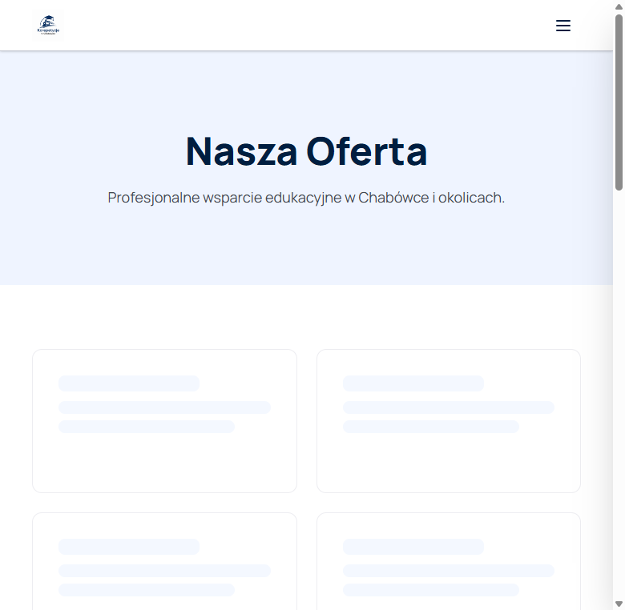
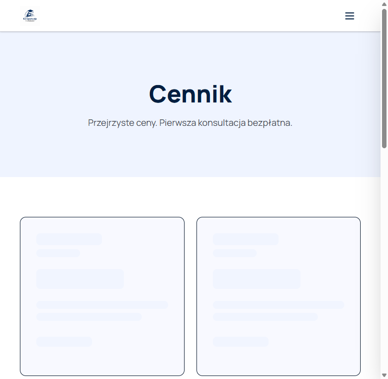
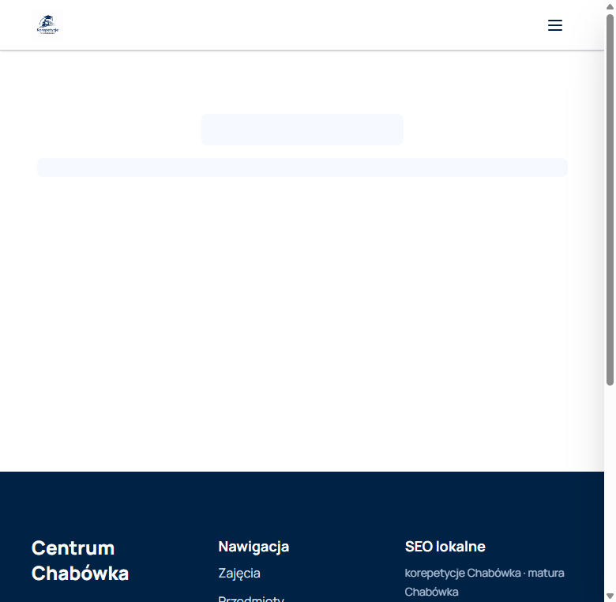

# Centrum Korepetycji Chabówka


A modern Polish tutoring centre website built with React, TypeScript, Vite and Firebase. The application presents tutoring subjects and courses, pricing, news, testimonials, FAQs and contact information. It also includes authentication, a shopping cart, course enrolment and a protected content-management panel.

## Screenshots

| Home page | Subjects |
| --- | --- |
|  |  |

| Pricing | Contact |
| --- | --- |
|  |  |

The screenshots show the public application with sample content. They do not contain administrator credentials or private user data.

## Features

- Responsive public website for desktop and mobile
- Subject and course catalogue with detailed course pages
- Pricing, news, testimonials, FAQ and contact pages
- Shopping cart and course enrolment flow
- Email/password authentication for students
- Protected administration panel for editing:
  - site settings and navigation
  - subjects, education levels and courses
  - pricing, posts, testimonials and FAQs
  - contact form, footer and SEO settings
  - enrolments, messages and email settings
- Firebase Authentication, Firestore and Storage integration
- SEO metadata, sitemap and Netlify SPA redirects
- Lazy-loaded routes and optimized static assets

## Tech stack

- React 19
- TypeScript
- Vite
- React Router
- Firebase Authentication, Firestore, Storage and Analytics
- Tailwind CSS
- Netlify deployment configuration

## Local development

### Requirements

- Node.js 20 or newer
- A Firebase project with Authentication and Firestore enabled

### Installation

```bash
npm install
Copy-Item .env.example .env
```

Fill `.env` with your own Firebase web-app configuration:

```dotenv
VITE_FIREBASE_API_KEY="your-value"
VITE_FIREBASE_AUTH_DOMAIN="your-project.firebaseapp.com"
VITE_FIREBASE_PROJECT_ID="your-project-id"
VITE_FIREBASE_STORAGE_BUCKET="your-project.firebasestorage.app"
VITE_FIREBASE_MESSAGING_SENDER_ID="your-value"
VITE_FIREBASE_APP_ID="your-value"
VITE_FIREBASE_MEASUREMENT_ID="your-value"
VITE_SITE_URL="http://localhost:5173"
```

Start the development server:

```bash
npm run dev
```

The site is then available at `http://localhost:5173`.

## Firebase setup and sample data

1. Create a Firebase project.
2. Enable Email/Password under Firebase Authentication.
3. Create a Firestore database and publish the rules from `firestore.rules`.
4. Add the Firebase web-app values to `.env`.
5. Add local seed credentials to `.env`:

   ```dotenv
   SEED_ADMIN_EMAIL="your-admin-email"
   SEED_ADMIN_PASSWORD="use-a-strong-local-password"
   ```

6. Run the initial seed when required:

   ```bash
   npm run seed
   ```

   Additional content can be loaded with `npm run seed:posts` and `npm run seed:courses`.

Seed credentials are intentionally required through environment variables. Never commit `.env`, passwords, Firebase service-account files or private keys.

## Available scripts

| Command | Description |
| --- | --- |
| `npm run dev` | Start the Vite development server |
| `npm run build` | Type-check and create a production build |
| `npm run preview` | Preview the production build locally |
| `npm run seed` | Create the initial Firebase data set |
| `npm run seed:posts` | Add sample news posts |
| `npm run seed:courses` | Add sample courses |
| `npm run optimize:images` | Optimize project images |

## Deployment

The repository includes `netlify.toml` for Netlify deployment. Set the same `VITE_*` values as environment variables in the hosting provider, run `npm run build`, and publish the `dist` directory. Do not add production secrets to the repository.

## Security

- `.env` and other environment files are ignored by Git; `.env.example` contains placeholders only.
- Seed scripts do not contain default passwords and fail clearly when credentials are missing.
- Firebase client configuration is loaded from environment variables.
- Service-account files, private keys and certificate files are ignored.
- Review Firebase Authentication and Firestore rules before deploying to production.

## License

No license has been specified for this project yet. Add a license before distributing the source code publicly.
